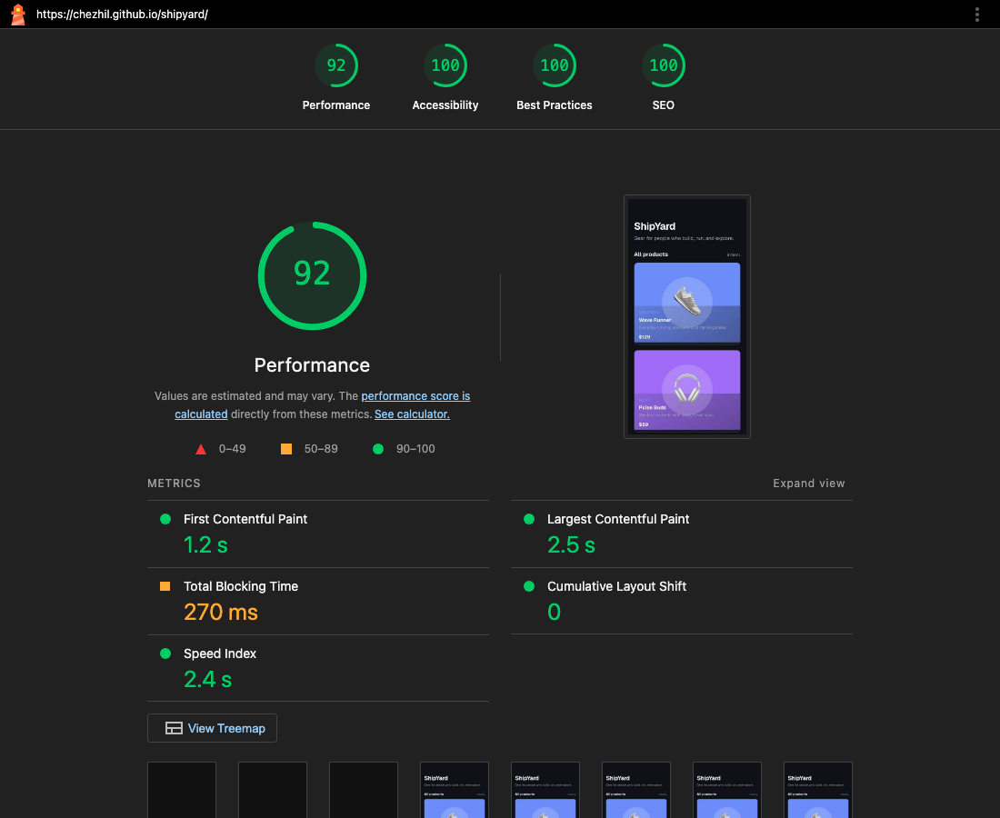

# ShipYard

A product-catalog storefront built with Next.js + TypeScript.

- Repo: https://github.com/chezhil/shipyard
- Live site: https://chezhil.github.io/shipyard/
- Lighthouse Performance: 92 (mobile, measured on the live site; Accessibility 100, Best Practices 100, SEO 100)



## Run locally

```bash
npm install
npm run dev
```

## What it does

Browse a product grid and open a detail page for each product.
Optimized with next/image, next/font, lazy loading (next/dynamic), and per-page
metadata. Has loading, error, and not-found states. Static-exported and
deployed to GitHub Pages with GitHub Actions.
